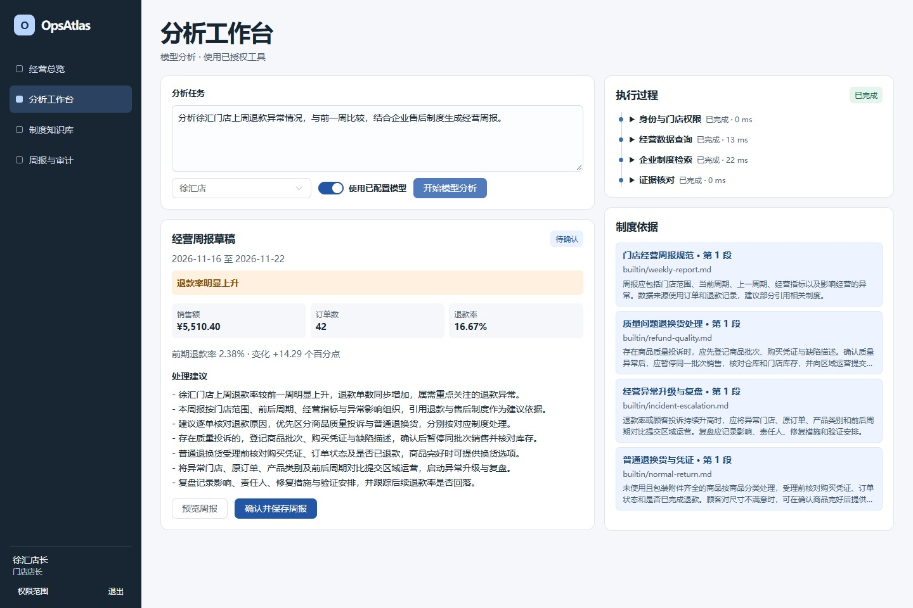
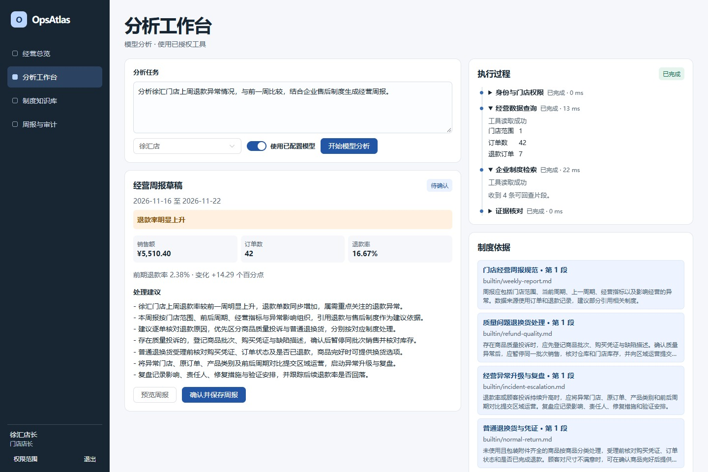
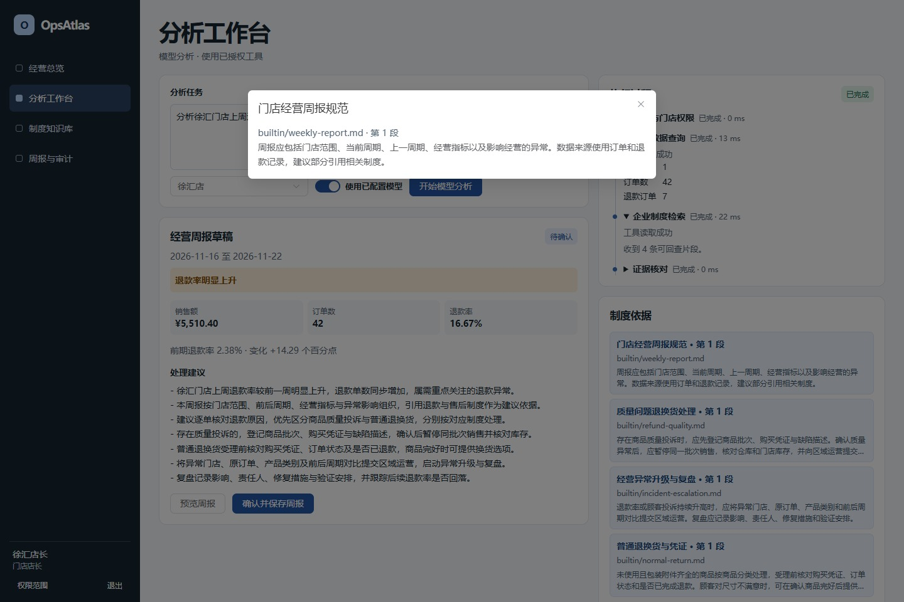
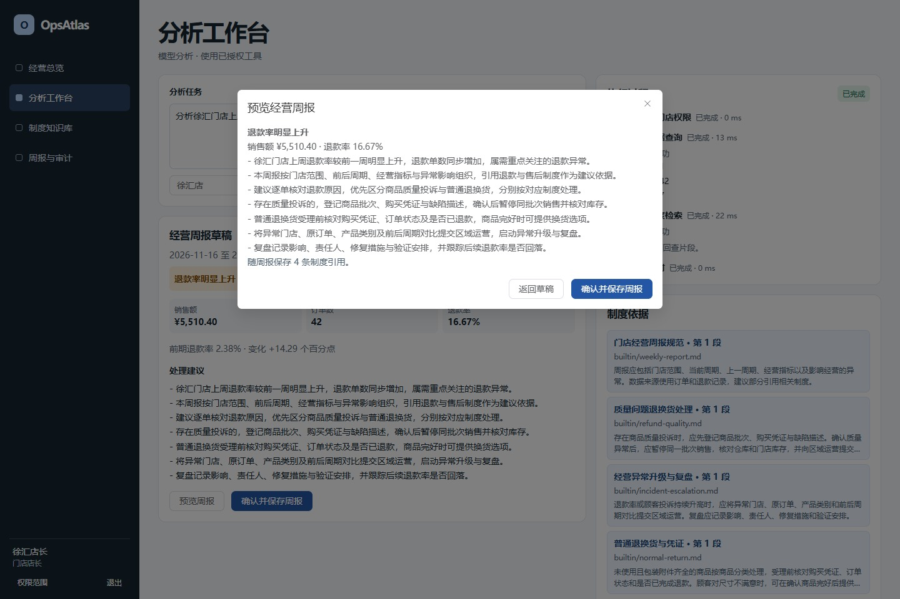
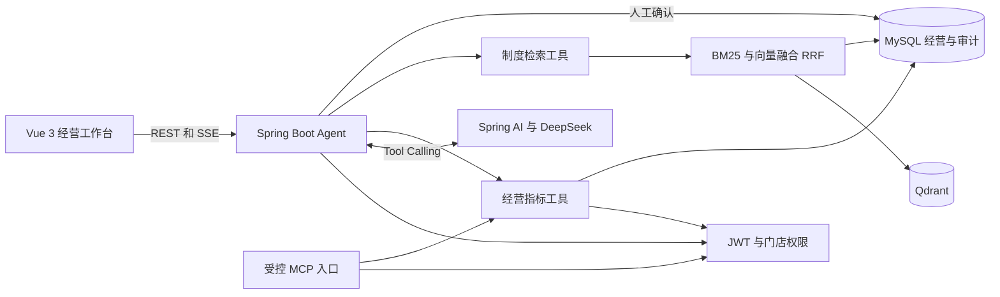

# OpsAtlas 企业经营分析 Agent

OpsAtlas 把门店权限、经营统计、制度证据和周报确认串成一条可审计链路。门店负责人提出经营问题，Java 工具查授权范围的订单和退款，Spring AI 协调模型及工具，用户查看来源并确认保存周报。



| 真实工具 | 制度原文 | 周报确认 |
| --- | --- | --- |
| [](docs/showcase/screenshots/desktop/04-tools.jpg) | [](docs/showcase/screenshots/desktop/05-citation.jpg) | [](docs/showcase/screenshots/desktop/06-report-confirmation.jpg) |

[经营看板](docs/showcase/screenshots/desktop/01-overview.jpg) · [工具执行时间线](docs/showcase/screenshots/desktop/04-tools.jpg) · [RAG 原文回查](docs/showcase/screenshots/desktop/05-citation.jpg) · [周报确认](docs/showcase/screenshots/desktop/06-report-confirmation.jpg)

分析截图来自隔离 Docker 环境对官方 DeepSeek 的真实调用，业务库和企业制度为合成演示数据。 [场景与截图模式](docs/showcase/demo-guide.md)

## 从提问到可追溯周报

用户选择已授权的门店并提交问题。Spring AI 模型按工具契约调用 Java Service，Java 校验数据权限并查询 MySQL。RAG 返回相关制度和可回查片段，后端通过 SSE 返回实际执行步骤、经营证据与草稿。用户确认后周报保存并生成审计记录。



| 层 | 技术 |
| --- | --- |
| Java 与数据 | Java 17、Spring Boot、Spring Security JWT、MyBatis、Flyway、MySQL |
| AI 与检索 | Spring AI、DeepSeek、Tool Calling、Qdrant、BM25、RRF、Agent、MCP、SSE |
| 前端与部署 | Vue 3、TypeScript、Vite、Element Plus、Docker Compose |

## 工程亮点与量化结果

| 能力 | 实现与证据 |
| --- | --- |
| 经营数据与门店权限 | 权限边界由 Java 校验，24 组场景完成独立 SQL 对照，360/360 指标一致，24/24 跨店请求拒绝 |
| Spring AI Tool Calling | 真实 DeepSeek 调用在 9 次任务中执行了 18/18 个预期 Java 工具项，SSE 完成事件 P95 约 2.79 秒 |
| RAG 混合检索 | 固定 20 问的标注集上 RRF Recall@3 100%，Hit@1 16/16，无答案拒答 4/4；BM25 的对应指标持平 |
| Agent 与 MCP | 9/9 真实端到端、8/8 MCP 越权拦截、72/72 人工确认规则。受控工具调用与周报确认均有审计 |
| 结果可追溯 | 浏览器逐步展示 SSE、工具证据与原始制度片段，草稿经确认后落库 |

这些量化来自本地 Docker、固定标注和合成经营数据。原专项与本次展示烟测使用不同样本。 [测试口径与结果](docs/showcase/verification.md)

## 运行

从仓库根目录执行。需要 Docker Engine、Docker Compose、可编译 Java 17 的 JDK（开发环境验证用 JDK 21）、Maven、Node.js 24 和 pnpm 11.25.0。

```powershell
. .\deploy\init-local.ps1
mvn -f backend/pom.xml -DskipTests package
pnpm --dir frontend install --frozen-lockfile
pnpm --dir frontend build
docker compose --env-file .runtime/local.env -f deploy/compose.yaml up -d --build --wait
```

打开 [经营工作台](http://127.0.0.1:8092)。新数据库根据当前周初始化前两周的数据。用 xuhui、east 或 hq 演示门店、区域、总部视图，密码由初始化生成并存于本机 .runtime/local.env。启动时缺少模型密钥可使用本地 evidence 流程。提供方调用会将合成经营汇总和匹配制度发送给模型。

在 Windows PowerShell 7 中配置真实 DeepSeek 时使用项目脚本，密钥由 DPAPI 保存在本机。重新加载配置后让 Compose 接收环境变量。

```powershell
.\deploy\set-model-key.ps1
. .\deploy\init-local.ps1
docker compose --env-file .runtime/local.env -f deploy/compose.yaml up -d --no-deps app
```

## 测试和资料

运行 Java 回归前，先启动本仓库的 MySQL 与 Qdrant，并加载本机配置。

```powershell
. .\deploy\init-local.ps1
mvn -f backend/pom.xml test
pnpm --dir frontend build
node tests/e2e/browser.cjs http://127.0.0.1:8092 portfolio-check
```

- [隔离演示和截图](docs/showcase/demo-guide.md)
- [系统架构](docs/architecture/system.md) · [Agent API](docs/api/agent.md) · [权限和业务 API](docs/api/business.md) · [MCP API](docs/api/mcp.md)
- [检索标注](docs/evaluation/retrieval.jsonl) · [量化证据](docs/showcase/verification.md)
