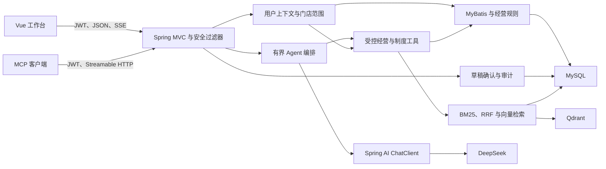

# 系统架构

## 模块接口

经营模块以授权后的门店集合绑定 SQL 查询，订单、退款与区域分组都由业务层计算。账号有效性和地区或门店权限从数据库读取。JWT 仅传递已签名主体。

Agent 每轮显式处理 Spring AI 返回的工具调用。经营工具和制度工具分开执行，工具不能自选身份或写入数据。服务端限制并行任务队列、请求超时、查询范围及工具数量。业务事实放入数据库驱动的结构化证据，模型建议字段过滤数字主张。退款异常规则为当前有订单且退款率环比上升至少五个百分点。

知识库保存原文、来源和可追踪片段。上传需总部权限。Qdrant 向量与 BM25 通过 RRF 合并，候选还需满足词项证据。无相关制度时 UI 与服务端都显示拒答。当前默认嵌入为字符特征哈希，可独立于聊天服务替换。

报告确认使用独立的授权接口，只提交确认布尔值。服务端锁定当前账号的已保存草稿，复制内容写入周报和审计。重复确认使用同一报告。应用启动时恢复中断会话状态。

## 隔离

Compose 项目 `opsatlas` 使用网络 `opsatlas_default`、数据库卷 `opsatlas_mysql` 及向量卷 `opsatlas_qdrant`。主机入口 8092，数据库 13392，向量服务 16342，均绑定回环。共享 Docker Engine。OpsAtlas 配置独立。

## 运行范围

这是单进程、本机演示环境，合成账号使用仅保存在本地的同一随机演示密码。源数据以独立的 Flyway 迁移装载。应用浏览与统计经营数据，周报和制度上传分别使用专门的写入接口。
